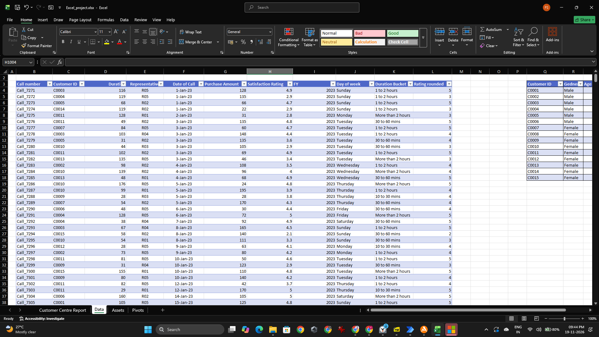
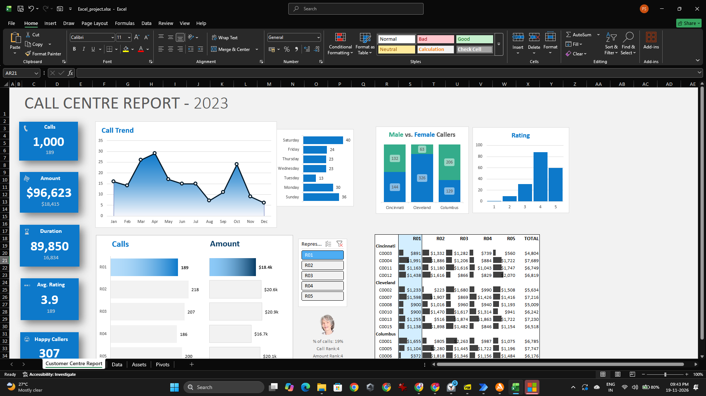

# Call-Centre-excel-dashboard
Practice project: interactive Excel dashboard analysing calls, amount, duration and ratings by rep, with slicers and KPI cards.

## Project Overview

This project focuses on analysing call centre data using Microsoft Excel. The aim is to turn raw call records into an interactive dashboard that provides an overview of call centre activity, customer satisfaction, and representative performance.

The analysis was carried out in Excel, starting with the dataset and preparing additional fields before building the dashboard.

## Data Preview

The dataset contains call records along with customer IDs, call duration, representative details, call dates, purchase amounts, and satisfaction ratings. Additional columns were created during data preparation, including **FY**, **Day of Week**, **Duration Bucket**, and **Rating Rounded**, to support further analysis and visualization in the dashboard.

## Dashboard Preview

The interactive dashboard provides an overview of call centre performance through key metrics and visualizations. It highlights call trends, customer demographics, satisfaction ratings, call distribution by weekday, and representative-wise performance, with an interactive representative filter for deeper analysis.

## Key Metrics

- Total Calls
- Total Purchase Amount
- Total Call Duration
- Average Customer Rating
- Happy Callers

## Dashboard Features

- **Call Trend:** Monthly distribution of calls throughout the year.
- **Calls by Weekday:** Comparison of call volumes across different days of the week.
- **Male vs. Female Callers:** Caller distribution by gender across cities.
- **Customer Ratings:** Distribution of satisfaction ratings.
- **Representative Performance:** Comparison of calls and purchase amounts by representative.
- **Detailed Breakdown:** City-wise and customer-wise purchase amount details by representative.
- **Interactive Filter:** Representative slicer to explore the dashboard for individual representatives.

## Data Preparation

The dataset was prepared in Excel by adding calculated/helper columns to make the data easier to analyse:

- **FY:** Extracted the year from the call date.
- **Day of Week:** Identified the weekday for each call date.
- **Duration Bucket:** Grouped call durations into time ranges.
- **Rating Rounded:** Rounded satisfaction ratings for rating-based analysis.

## Tools Used

- Microsoft Excel
- Excel Tables
- PivotTables
- PivotCharts
- Slicers
- Formulas and data preparation

## Files Included

- `data.xlsx` – Dataset used for the analysis.
- `data.png` – Screenshot of the prepared dataset.
- `dashboard-image.png` – Screenshot of the completed dashboard.
- `call-centre-dashboard.xlsx` – Excel workbook containing the analysis and dashboard.
- `README.md` – Project documentation.

---

*This is an Excel practice project created to strengthen data preparation, analysis, and dashboard-building skills.*

